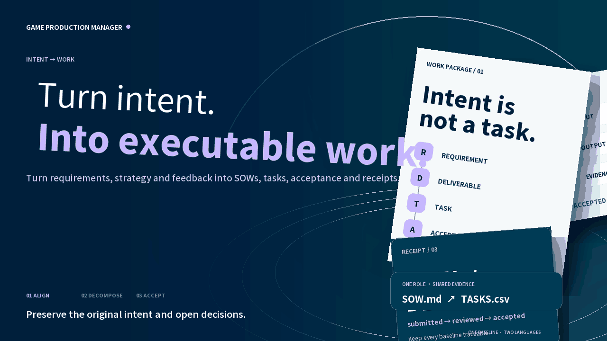

# Game Production Manager

[中文](README.md)

<picture>
  <source media="(prefers-reduced-motion: reduce)" srcset="assets/readme/hero-en.png">
  
</picture>

[▶ Watch the 24-second MP4](assets/readme/hero-en.mp4) · [中文 MP4](assets/readme/hero-zh.mp4)

Turn the goals, plans, strategies, and feedback from game directors, producers, Art Directors, and technical leads into SOWs, asset lists, work packages, human/agent tasks, milestones, and acceptance targets. This role understands, coordinates, and tracks work. Named executors still create the game, code, art, audio, and tests.

[30-second start](docs/HUMAN-GUIDE.en.md) · [Agent guide](docs/AGENT-GUIDE.en.md) · [Read the canonical skill](SKILL.md) · [Production contract](references/production-contract.md) · [Darwin review](evals/darwin-review.md)

  

## What it owns

[](assets/readme/workflow-en.png)

```text
Goal / requirement → Feature → Deliverables and assets → Work packages → Role tasks
                                             ↓
                               Dependencies / milestones / acceptance / receipts
```

Every task names its owner, input, action, output, dependencies, stop conditions, and evidence requirement. `render` creates the SOW, task CSV, role views, and preserved source package. `impact` traces downstream effects of feedback. Without a real artifact and review evidence, a task cannot become `accepted`.

## Start now

```text
git clone https://github.com/NewenergyEric/game-production-manager.git
cd game-production-manager
python scripts/production.py validate examples/merge-package.json
python scripts/production.py render examples/merge-package.json --out outputs/merge-sow
python scripts/production.py impact examples/merge-package.json --changed D-ORDER
```

Ask an agent with GitHub or local-file access to read `SKILL.md` first, then provide the source requirements, confirmed decisions, constraints, and feedback. The core tool uses only the Python 3.10+ standard library.

## Role handoffs

| Role | Delivery |
|---|---|
| [Game Market Intelligence Director](https://github.com/NewenergyEric/game-market-intelligence) | Market evidence, business judgment, and validation gaps |
| [Game Reverse Analyst](https://github.com/NewenergyEric/game-reverse-analyst) | Mechanics, architecture, asset structure, BOM, and unknowns |
| Game Production Manager | SOW, WBS, tasks, acceptance, and change impact for confirmed direction |
| [Art Director](https://github.com/NewenergyEric/art-director-skill) | Art baseline, asset families, exemplars, and professional review |

## Boundaries

A completed plan is not a completed production. Without an actual deliverable, test evidence, and acceptance authority, do not mark work `accepted`. When an agent is asked to produce the work directly, first define its execution contract, required tools and permissions, budget, and stop conditions. Do not fabricate output, assign outside people automatically, or overwrite a distributed baseline.

The Merge/community example demonstrates the package format; it is not an approved game scope. Run `python -m unittest discover -s tests -v` to validate the tool. Tests, Darwin prompts, and available work are in [`evals/`](evals/) and [ROADMAP.md](ROADMAP.md); project comparisons are in the [GitHub reference scan](references/github-reference-scan.md).

MIT licensed. Private project material, credentials, and real deliverables stay outside the repository.
