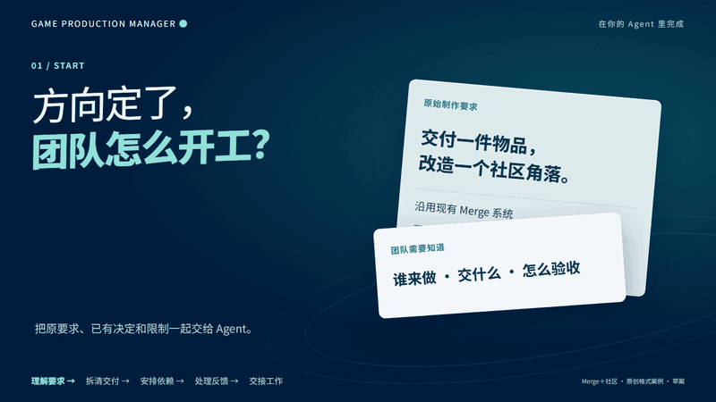
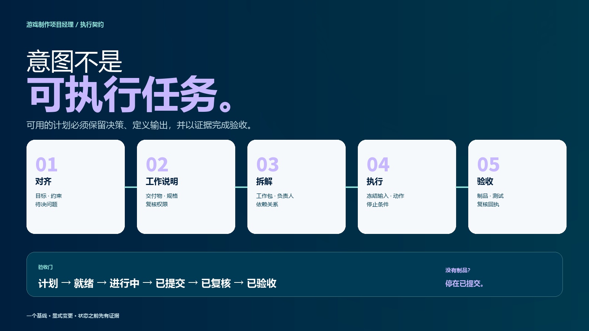

# 游戏制作项目经理

[English](README.en.md)

<picture>
  <source media="(prefers-reduced-motion: reduce)" srcset="assets/readme/hero-zh.png">
  
</picture>

把主策、制作人、主美或技术负责人的目标、计划、策略和反馈，拆成 SOW、资产清单、工作包、岗位／Agent 任务、里程碑和验收目标。这个岗位负责理解、协调和追踪；实际游戏、代码和美术制作由明确的执行者完成。

[30 秒开始](docs/HUMAN-GUIDE.md) · [Agent 调用说明](docs/AGENT-GUIDE.md) · [读取 Skill](SKILL.md) · [工作包契约](references/production-contract.md) · [Darwin 审查](evals/darwin-review.md)

  

## 它负责什么

[](assets/readme/workflow-zh.png)

```text
目标 / 需求 → Feature → 交付物与资产 → 工作包 → 岗位任务
                                  ↓
                         依赖 / 里程碑 / 验收 / 回执
```

每个任务带责任角色、输入、动作、输出、依赖、停止条件和证据要求。`render` 生成 SOW、任务 CSV、岗位视图和原包，`impact` 追踪反馈对下游任务的影响。没有实际制品和复核证据，状态不能进入 `accepted`。

## 立即使用

```text
git clone https://github.com/NewenergyEric/game-production-manager.git
cd game-production-manager
python scripts/production.py validate examples/merge-package.json
python scripts/production.py render examples/merge-package.json --out outputs/merge-sow
python scripts/production.py impact examples/merge-package.json --changed D-ORDER
```

把仓库交给能读取 GitHub 或本地文件的 Agent，要求它先读 `SKILL.md`，再提供原始需求、已确认决定、限制和反馈。Python 3.10+，核心工具只使用标准库。

## 岗位协作

| 岗位 | 交付 |
|---|---|
| [游戏市场研究总监](https://github.com/NewenergyEric/game-market-intelligence) | 市场证据、经营判断和待验证项 |
| [游戏拆解与逆向分析师](https://github.com/NewenergyEric/game-reverse-analyst) | 玩法、架构、资产结构、BOM 和未知项 |
| 游戏制作项目经理 | 已确认方向的 SOW、WBS、任务、验收和变更影响 |
| [美术总监](https://github.com/NewenergyEric/art-director-skill) | 美术基线、资产家族、样板和专业评审 |

## 重要边界

计划完成不等于制作完成；没有实际产物、测试证据和验收 authority，不得标记 `accepted`。如果 Agent 被要求直接制作，先输出执行契约、所需工具／权限、预算和停止条件，不虚报结果，不自动指派外部人员，也不覆盖已经分发的版本。

示例是 Merge／社区方向的格式案例，不是已批准的游戏范围。运行 `python -m unittest discover -s tests -v` 验证工具。测试、Darwin prompts 和可接手任务见 [`evals/`](evals/) 与 [ROADMAP.md](ROADMAP.md)；同类项目取舍见 [GitHub 参考扫描](references/github-reference-scan.md)。

本仓库使用 MIT；私人项目资料、账号配置和真实交付物不随仓库发布。
